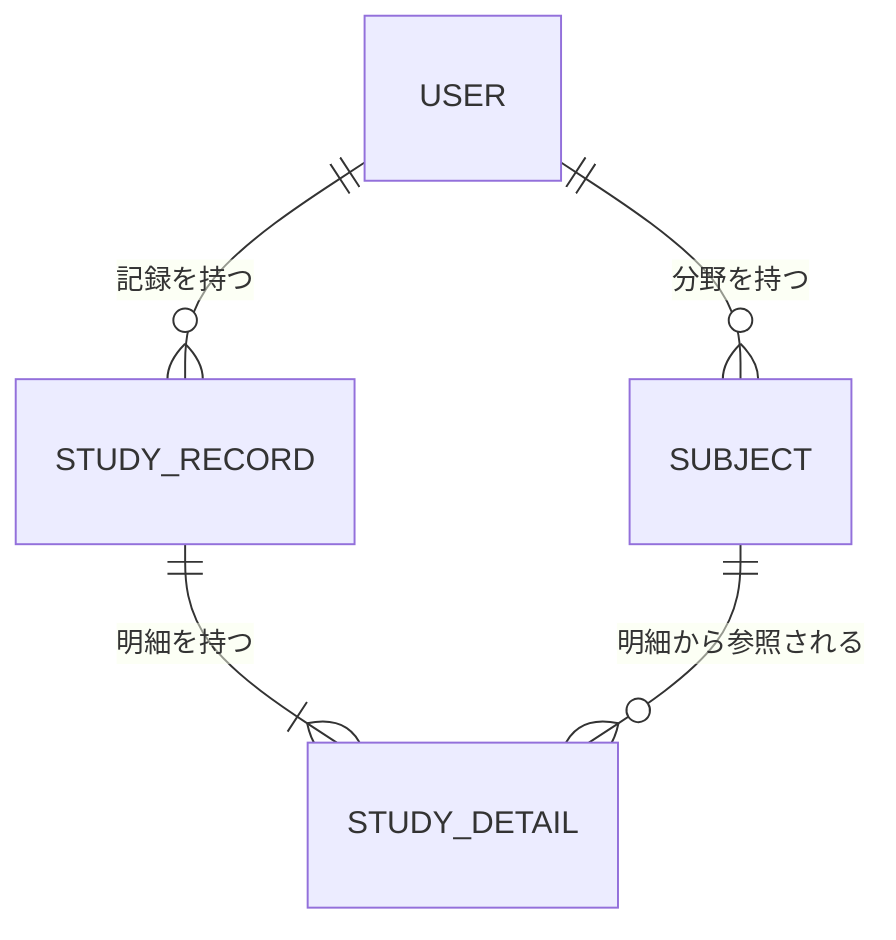

# 学習記録アプリ 設計メモ

この文書は、制作前の対話で整理した目的・機能・設計方針を残すものです。
既存コードの実装状況を示す仕様書ではありません。実装は本人が学習しながら進め、決定内容が変わったら更新します。

## 設計の進め方

1. まず、最終的に目指すアプリ全体の完成像を設計します。機能・画面・データ・API・エラー時の動作を整理し、未決定事項を具体化します。
2. 全体設計から、2週間で実装する仕様を切り分けます。CRUD・入力チェック・基本的なエラー処理を中心に、機能の依存関係と実装負担も見て選びます。
3. 2週間版に含めない機能も全体設計に残し、以降の目標として管理します。

全体の完成像と、2週間版の完成条件は別です。以下の全体仕様にある「最初の完成版」は、これまで考えたアプリの基本完成像を指し、すべてを2週間以内に実装する意味ではありません。
末尾の切り分け案は仮案として保持し、全体設計を整理した後に確定します。無制限に例外を増やすのではなく、想定する使い方に必要な設計を決めます。

## 目的

学習時間と勉強した分野を記録し、積み重ねを振り返ることで、学習のモチベーション維持につなげます。

分野が変わるたびに計測を止める手間をなくし、勉強が終わってからまとめて記録できるようにします。

## 利用対象と完成範囲

- 最初は自分用のアカウントで使うアプリとします。
- 最初の完成版にログイン・ログアウトを含めます。
- 最初はPC向けに完成させます。スマホ表示の調整・動作確認はPC版の完成後に行い、最初の完成条件には含めません。
- 最初の完成版の計測はストップウォッチのみとし、カウントダウンタイマーやモード切り替えは含めません。タイマーを将来追加するかは未決定です。
- ほかの人も利用できる形への拡張を将来の目標とします。
- グラフはポートフォリオとして完成した後に追加します。
- 計測の一時停止・再開は最初の完成版には含めず、将来追加します。
- 割合による配分は最初の完成版には含めず、将来スライダーで調整できるようにします。
- 今日・今月など、期間を絞った集計は将来追加します。

## 基本の利用の流れ

1. ログインする。
2. 最初に表示される計測画面で計測を開始する。
3. 勉強中に分野が変わっても、そのまま計測を続ける。
4. 終了後、記録入力モーダルを開く。
5. 分野ごとに実際の学習時間を入力し、必要ならメモを添える。合計学習時間は自動計算する。
6. 保存した記録や集計を見て振り返る。

## 最初の完成版に必要な機能

| 機能 | 内容 |
|---|---|
| ログイン・ログアウト | 自分用のアカウントで利用する |
| 時間計測 | ストップウォッチで開始から終了までの経過時間を計測する。一時停止・再開は将来追加する |
| 計測の継続・復元 | 画面移動中も計測を継続し、再読み込みやタブを開き直した後も開始日時から復元する |
| 合計学習時間の自動計算 | 分野別に入力した時間を合計する。合計の入力欄は設けず、分野別の時間を変更して調整する |
| 分野への配分 | 複数分野それぞれの時間を「時間」「分」に分けて直接入力する（例：1時間30分）。割合・スライダーは将来追加する |
| メモ | 分野ごとに任意で記入できる |
| 分野の追加 | 自分で自由に追加し、次回以降も選択できる |
| 記録の管理 | 計測せずに手動追加でき、保存済み記録を編集・削除できる |
| 学習時間の集計 | トータル学習時間と分野別学習時間を、累計の数値で表示する。今日・今月などの期間別集計は将来追加する |
| カレンダー | 各日付に合計学習時間を表示し、日付を選ぶと詳細モーダルで記録を確認できる |

### 計測中の画面移動と復元

| 操作 | 動作 |
|---|---|
| アプリ内の別画面へ移動 | 計測を続ける |
| 別タブを見る・ブラウザーを最小化 | 計測を続ける |
| 再読み込み・タブを閉じて開き直す | 保存した開始日時から計測中の状態を復元する |
| 終了ボタンを押す | 終了日時を確定し、記録入力モーダルを開く |

- この動作を最初の完成版に含めます。
- 経過時間は開始日時と現在日時の差で求めます。表示更新の回数を時間として数えません。
- 計測中の開始日時はブラウザーの `localStorage` に保存し、同じPC・ブラウザー・オリジン内で復元します。別端末への同期は最初の完成版には含めません。
- 保存キーはサーバー側で確認したログインユーザーのIDごとに分け、別ユーザーの計測状態を引き継がないようにします。localStorageの値を認証・認可の根拠には使いません。
- 再表示時は保存した開始日時と現在日時の差で経過時間を求めます。タブを閉じている間も処理が動き続けるわけではありません。
- 終了時は終了日時を確定し、localStorageの計測中の状態を削除します。確定した学習記録は従来どおりMySQLへ保存します。
- localStorageにはパスワードなどの認証情報を保存しません。サイトデータを削除した場合などは計測状態を復元できません。
- 終了時に計測中の状態を解除し、以後は終了日時で確定した計測時間を使います。記録入力中に経過時間は増えません。
- 計測中の復元と、終了後の記録入力途中の内容の復元は別の機能です。後者は将来対応のままとします。

### 計測中のログアウトと複数タブ

- 計測中にログアウトする場合は「ログアウトすると計測中の時間は破棄されます。ログアウトしますか？」と確認します。
- 確認を取り消した場合はログアウトせず、計測を続けます。
- ログアウトを確定した場合は計測を中止し、そのユーザーの計測開始日時をlocalStorageから削除します。中止した計測を学習記録としてDBへ保存しません。
- 別サイトのタブを見ている間も計測は続きます。バックグラウンドで毎秒処理を続ける必要はなく、戻ったときに開始日時から経過時間を求めます。
- 同じブラウザー・オリジンでアプリを複数タブに開いた場合は、同じユーザーの1件の計測を共有し、二重に開始しないようにします。
- いずれかのタブで計測を終了したら、他のタブにも終了を反映します。記録入力モーダルは、終了操作をしたタブで開きます。
- いずれかのタブでログアウトしたら、他のタブにもログアウトと計測中止を反映します。
- タブ間の通知方法や同時操作時の競合防止は、実装時に具体化します。

### 時間配分の例

計測時間が120分でも、JavaScriptに60分、CSSに40分と直接入力できます。
分野別に入力した時間の合計が計測時間と異なっていても、保存を妨げません（多い場合・少ない場合ともに許可）。
合計学習時間は分野別の入力から自動計算し、トータル学習時間の集計にもこの値を使います。合計を別途入力する必要はありません。
計測時間と入力合計が異なる場合は、差があっても保存できることを注意文で伝えます。
表示例：「計測時間は120分、入力合計は110分です。このまま保存できます」。数値は実際の値に置き換えます。

「JavaScript」のような分野を集計に使い、「配列操作を勉強した」のような具体的な内容は任意のメモに残します。

### 時間の入力・表示ルール

- 分野ごとの時間は「時間」「分」に分けて入力します。30分の場合は「0時間30分」とします。
- 時間欄は0以上の整数、分欄は0〜59の整数とし、小数・負数は受け付けません。
- 各分野の学習時間は1分以上を必須とします。
- 1回の記録の合計学習時間は24時間以内とします。各行が範囲内でも、合計が24時間を超える場合は保存できません。手動追加でも同じ上限を適用し、必要なら記録を分けます。
- 計測中の経過時間は秒まで表示します。
- 計測結果を分単位で扱う場合は、秒の端数を切り捨てます（例：1時間30分45秒は1時間30分）。
- 計測時間と入力合計の注意表示は、秒を切り捨てた分単位で比較します。分単位で同じなら注意文は表示しません。
- 1分未満の計測でも、分野ごとに1分以上の学習時間を入力すれば記録できます。分単位の計測時間は0分となるため、入力合計との差の注意文を表示します。

### 分野の管理

- 学習記録に使われていない分野は、DBから実際に削除できます。
- 学習記録で使用中の分野は削除できません。「学習記録で使用されているため削除できません」と表示します。
- 分野の削除によって、過去の学習記録・時間・メモが消えないようにします。
- 使用中の分野でも名前を変更できます。過去の記録にも新しい名前を表示し、同じ分野として集計します。

### 学習日の扱い

- 計測した記録の学習日は、計測を開始した日を初期値にします。
- 手動追加では、今日の日付を初期値にします。
- 入力・編集時に学習日を変更できます。
- 日付をまたいでも自動分割せず、選んだ日に全時間をまとめます。例えば10月17日23時から18日1時までの学習は、初期値では10月17日の2時間として扱います。

### 記録全体・明細の削除

- 日別の記録詳細で「削除」を押し、確認後に1回の学習記録とその明細をまとめて削除します。
- 分野ごとの明細を消したい場合は、編集モーダルで該当する行を削除し、「更新する」で確定します。
- 編集途中の行削除はDBに反映せず、変更を破棄すれば元の記録を維持します。
- 更新後の合計時間は、残った明細から自動計算します。
- 明細が0件の場合は更新できません。全体を消す場合は、記録全体の削除を使います。

### カレンダーと日別の記録詳細

- カレンダーの各マスには日付と、その日の合計学習時間を「2時間30分」のように表示します。合計は保存した明細の学習時間から求めます。
- 学習記録がない日は、時間表示を空欄にします。
- 日付を押すと日別の記録詳細モーダルを開き、選択した日付とその日の合計学習時間を表示します。
- 詳細では1回の記録ごとにまとめ、その記録の合計時間と、各明細の分野・時間・メモを表示します。同じ分野の複数行も、まとめずに各行を表示します。
- 各記録に「編集」「削除」を設けます。削除は確認後に記録全体を削除する既存の方針に従います。
- 詳細モーダルには「記録を追加」「閉じる」を設けます。記録がない日でも手動追加できます。
- 日別の詳細モーダルは閲覧用です。記録入力モーダルの「記録する・破棄する」の2択とは区別します。
- 最初は日付と合計時間を中心とした表示にし、色分けやグラフを増やさない構成にします。

### 分野の同名登録

同じユーザー内では重複不可とし、前後の空白を取り除いたうえで、大文字・小文字を区別せずに判定します。例えば `JavaScript` と `javascript` は同じ名前として扱い、別分野として重複登録できません。別ユーザー間の同名は許可します。
これは分野名の重複登録のルールです。同じ分野を複数の学習明細で選択することは引き続き可能です。
具体的なMySQLの照合順序と、大文字・小文字以外の文字の同一視（全角・半角、アクセントなど）は今後決めます。

## 画面構成の案

画面とモーダルの遷移は [画面遷移図](screen-flow.md) に整理しています。URLや未確定の表示方法は、図の中でも提案として区別しています。
PC向けの配置案は [画面レイアウト図](screen-layout.md) に整理しています。配置・追加の操作案は未確定です。
HTML・CSSとダミーデータによる画面デモを実装しています。現時点の範囲とバックエンド接続の手がかりは [画面デモのガイド](ui-demo.md) を参照してください。

主な入口は「計測」と「振り返り」です。計測終了後・手動追加・編集では、同じ記録入力モーダルを使います。
既存の `views/index.ejs` にある確認モーダル（`study-modal`）を基に、今後、複数分野の時間・メモの入力、合計学習時間の自動計算へ拡張する方針です。
現状は画面デモとして複数分野の入力・編集を実装済みですが、API・認証・DB保存は未接続です。

### 手動追加・編集でのモーダル利用

| 開き方 | 最初に表示する内容 | 確定ボタン |
|---|---|---|
| 計測終了後 | 計測時間・開始日 | 記録する |
| 手動追加 | 今日の日付・空の入力欄 | 記録する |
| 編集 | 保存済みの日付・分野・時間・メモ | 更新する |

- 入力チェックの処理を共通にします。
- 手動追加には計測時間がないため、計測時間との差の注意文は表示しません。
- 編集中はDBを書き換えず、「更新する」を押して保存に成功したときだけ反映し、モーダルを閉じます。
- 編集時は「変更を破棄する」を押すと確認を表示し、確定後にモーダルを閉じます。元の記録はそのまま残します。
- 編集時も入力エラーや保存失敗の場合は内容を残し、修正・再試行できるようにします。

### 計測終了後の記録入力モーダル

- 終了ボタンを押すと、直接入力・調整できる記録入力モーダルを表示します。
- 「変更」ボタンで編集状態へ切り替える操作や、別の確認画面は挟みません。
- 計測時間は結果として表示します。
- 合計学習時間は分野別の入力から自動計算して表示します。合計自体の入力欄は設けません。
- 分野の選択、分野ごとの時間、任意のメモを、その場で入力します。割合入力は将来追加します。
- 同じ分野を複数行に入力できます。各行に学習時間と任意のメモを持たせ、分野別学習時間の集計では同じ分野の各行の時間を合算します。
- 分野ごとの時間は「時間」「分」の2つの欄で入力します（例：1時間30分）。
- 保存する各分野の入力では、分野の選択と1分以上の学習時間を必須とします。分野未選択や時間未入力、0分のままでは保存できません。
- メモは任意で、空欄でも保存できます。
- 入力内容を同じモーダルで見直し、「記録する」ボタンで確定します。

### 記録入力モーダルの確定と破棄

- 背景クリックではモーダルを閉じません。
- 新規記録では「記録する」「破棄する」、編集では「更新する」「変更を破棄する」の2択とします。「閉じる」や「記録入力に戻る」は設けません。
- 「記録する」は入力チェックを行い、DBへの保存に成功したらモーダルを閉じます。入力エラーや保存失敗の場合は内容を残し、モーダル内で修正・再試行できるようにします。
- 「破棄する」は確認を表示し、破棄が確定した場合だけ未保存の記録を消します。確認を取り消した場合は内容を残します。
- 記録または破棄が完了するまで、背景クリック・Escキーなどで入力を確定せずにモーダルを閉じる操作は受け付けません。
- 最初の完成版では、未保存の入力はページを開いている間だけ保持します。再読み込みやタブを閉じた後の復元は将来の追加機能とします。
- 未保存の記録がある場合は、保存または破棄を済ませるまで次の計測を開始できません。
- 記録入力モーダルを開いている間は、背後の計測画面の開始ボタンを操作できないようにします。

| 画面・表示 | 内容 |
|---|---|
| ログイン | 自分のアカウントでログインする |
| 計測 | ログイン後の最初の画面。学習時間を計測する |
| 記録入力・編集 | 学習日、分野別の時間、メモを入力し、自動計算された合計学習時間を確認する |
| 振り返り | トータル時間、分野別時間、カレンダーを表示する |
| 日別の記録詳細 | カレンダーからモーダルを開き、日別合計と記録・明細を確認する。記録の編集・削除、手動追加ができる |

## 技術方針

- サーバー：Java＋Spring Boot
- DB：MySQL
- 認証：Spring Securityを使う方針
- 既存のExpress部分：Spring Bootへの置き換え対象
- 画面の実装方式：JavaScriptからSpring BootのAPIを呼び出す方式

Spring Bootは初めて使います。学習しながら、表示・DB保存などの小さな流れから実装します。
ログインを実装するまでの開発中は、固定の自分用ユーザーを使う案があります。その間は公開利用を前提にしません。

### 画面とAPIの連携

- 学習記録・分野の保存や取得は、ブラウザーのJavaScriptから `fetch()` でSpring BootのAPIを呼び出して行います。
- APIではJSON形式でデータを受け渡しし、JavaScriptで画面表示を更新します。
- HTML・CSS・JavaScriptもSpring Bootから配信し、同じオリジンのAPIを呼ぶ構成を基本とします。ReactやVueは必須としません。
- 入力検証と本人のデータだけを操作できる認可は、サーバー側でも行います。
- ログイン状態はSpring Securityのセッション方式で管理し、保存・更新・削除のAPI呼び出しにはCSRF対策を組み込みます。
- APIの呼び出し時に未認証であれば、サーバーは401を返します。JavaScript側で再ログインを案内し、ログイン画面への移動には通常の画面遷移を使います。
- ログイン画面はThymeleafで表示し、HTMLフォームからSpring Securityへ送信します。学習記録・分野の操作は引き続きfetch()でAPIを呼びます。

### ログインと初期アカウント

- ログイン画面にはユーザー名・パスワードの入力欄と「ログイン」ボタンを設けます。
- ログイン処理はSpring Securityのフォームログインを使い、フォームにはCSRFトークンを組み込みます。ログイン用のfetch()処理は作りません。
- ログイン成功時は計測画面へ移動します。
- 失敗時はログイン画面で「ユーザー名またはパスワードが正しくありません」と表示し、パスワードは再表示しません。
- ログイン状態は既定のセッション方式で管理し、長期間保持するRemember-me機能は最初の完成版には含めません。
- 最初の完成版は、ユーザー名とパスワードでログインします。
- 自分用アカウントを、開発用の初期データ作成処理で1件登録します。
- パスワードはSpring Securityの `PasswordEncoder` でハッシュ化し、DBに保存します。
- 初期アカウント作成時のパスワードは環境変数などから渡し、平文のパスワードをDBやGitに残しません。
- 新規ユーザー登録画面とパスワード再設定は、最初の完成版には含めず、将来追加します。
- ほかの人も利用する段階で、必要に応じてメールアドレスの登録・確認を追加します。

## データとアクセス制御の方針

- ユーザーが学習記録と分野を持つ構造にします。
- 1回の学習記録に対して、複数の「分野・学習時間・メモ」を持てる構造にします。
- テーブル構成・カラム名・型・制約は次のDB設計のとおりです。
- 記録の取得・編集・削除では、記録IDとログインユーザーIDの両方で絞り込む方式を採用します。
- ログインユーザーIDは、ブラウザーから送られた値を信用せず、サーバー側の認証情報から取得します。
- 分野も本人のものだけを利用できるようにします。
- 他人の記録を操作できないことを、テストで確認します。

## DB設計：決定した構成と保存方針

以下の4テーブルに分けます。ER図のUSER、SUBJECT、STUDY_RECORD、STUDY_DETAILは、それぞれ実際のテーブル名 `users`、`subjects`、`study_records`、`study_details` に対応します。

| テーブル | 保存するもの |
|---|---|
| ユーザー（USER） | ユーザーID、ログイン名、パスワードのハッシュなどのアカウント情報 |
| 分野（SUBJECT） | 分野ID、所有ユーザーID、分野名 |
| 学習記録（STUDY_RECORD） | 記録ID、所有ユーザーID、学習日、計測開始日時・終了日時 |
| 学習明細（STUDY_DETAIL） | 明細ID、学習記録ID、分野ID、学習時間、任意のメモ |

### テーブルの関係図（ER図）



### 図の読み方

ER図は、どの種類のデータが、ほかのデータと何件ずつ結び付くかを表す図です。線の両端の記号が件数を示します。

| 記号 | 意味 |
|---|---|
| `||` | 必ず1件 |
| `o{` | 0件以上（なくてもよく、複数あってよい） |
| `|{` | 1件以上（少なくとも1件必要） |

- `USER ||--o{ SUBJECT`：1人のユーザーは分野を0件以上持てます。各分野の所有者は必ず1人です。
- `USER ||--o{ STUDY_RECORD`：1人のユーザーは学習記録を0件以上持てます。各記録の所有者は必ず1人です。
- `STUDY_RECORD ||--|{ STUDY_DETAIL`：保存する1件の学習記録には、1件以上の明細が必要です。各明細は必ず1件の学習記録に属します。
- `SUBJECT ||--o{ STUDY_DETAIL`：1つの分野は明細から0回以上参照されます。各明細は必ず1つの分野を参照します。同じ記録内で同じ分野を複数回使えます。

例えば、1回の学習で「JavaScript・30分・配列操作」「JavaScript・45分・課題制作」「CSS・30分・レイアウト」を入力すると、学習記録を1件、学習明細を3件保存します。

### 基本の保存方針

- 学習時間は明細ごとに分単位の整数で保存します。画面の「1時間30分」はDBでは `90` とし、表示時に時間と分へ変換します。
- 合計学習時間は明細から計算し、独立した値として重複保存しません。上の例では合計105分、JavaScriptは75分です。
- 手動追加の記録では、計測開始日時・終了日時を両方とも `NULL`（値なし）にします。計測した記録では両方を保存し、手動追加と区別します。
- パスワードの元の文字列は保存せず、Spring Securityでハッシュ化した値を保存します。
- 計測途中の開始日時はユーザーごとにlocalStorageへ保存します。確定した記録を保存するこの4テーブルとは役割を分けます。

### カラム名・型・制約

カラム名は英語の `snake_case` とします。各テーブルの `id` は `BIGINT` の主キー・自動採番です。「必須」は `NOT NULL` を意味します。

#### users：ユーザー

| カラム | MySQLの型 | 制約・用途 |
|---|---|---|
| id | BIGINT | 主キー、自動採番 |
| username | VARCHAR(50) | 必須、一意。ログイン名 |
| password_hash | VARCHAR(255) | 必須。ハッシュ化したパスワード |
| created_at | DATETIME(3) | 必須。作成日時 |
| updated_at | DATETIME(3) | 必須。更新日時 |

ユーザー名は半角英数字とアンダースコアの3〜50文字とし、小文字に統一して保存します。

#### subjects：分野

| カラム | MySQLの型 | 制約・用途 |
|---|---|---|
| id | BIGINT | 主キー、自動採番 |
| user_id | BIGINT | 必須。users.idへの外部キー |
| name | VARCHAR(100) | 必須。前後の空白を除去し、空文字は禁止 |
| created_at | DATETIME(3) | 必須。作成日時 |
| updated_at | DATETIME(3) | 必須。更新日時 |

`(user_id, name)` に一意制約を付け、同じユーザー内の分野名の重複を禁止します。大文字・小文字を区別しない方針に合わせてDBの比較も統一します。具体的な照合順序は未決定です。

#### study_records：学習記録

| カラム | MySQLの型 | 制約・用途 |
|---|---|---|
| id | BIGINT | 主キー、自動採番 |
| user_id | BIGINT | 必須。users.idへの外部キー |
| study_date | DATE | 必須。カレンダー上の学習日 |
| started_at | DATETIME(3) | 計測開始日時。手動追加ではNULL |
| ended_at | DATETIME(3) | 計測終了日時。手動追加ではNULL |
| created_at | DATETIME(3) | 必須。作成日時 |
| updated_at | DATETIME(3) | 必須。更新日時 |

- 開始・終了日時は両方とも値あり、または両方ともNULLとするCHECK制約を付けます。
- 値がある場合は終了日時が開始日時以降とするCHECK制約を付けます。
- 合計学習時間のカラムは作りません。
- 日別検索用に `(user_id, study_date)` のインデックスを付けます。

#### study_details：学習明細

| カラム | MySQLの型 | 制約・用途 |
|---|---|---|
| id | BIGINT | 主キー、自動採番 |
| study_record_id | BIGINT | 必須。study_records.idへの外部キー |
| subject_id | BIGINT | 必須。subjects.idへの外部キー |
| duration_minutes | INT | 必須。CHECK制約で1〜1440分 |
| memo | VARCHAR(1000) | 任意。未入力はNULL |
| display_order | INT | 必須。CHECK制約で0以上。入力行の表示順 |

`(study_record_id, subject_id)` に一意制約は付けません。同じ分野を複数行に入力できます。

### 削除・整合性・保存処理

| 条件・操作 | ルール |
|---|---|
| 学習記録を削除 | 明細の外部キーをON DELETE CASCADEとし、明細も削除する |
| 使用中の分野を削除 | 明細の外部キーをON DELETE RESTRICTとし、削除を禁止する |
| 記録・分野があるユーザーを削除 | ユーザーへの外部キーをON DELETE RESTRICTとし、削除を禁止する。ユーザー削除機能は当面作らない |
| 明細が0件 | サーバー側で保存・更新を拒否する |
| 明細の合計が1440分を超える | サーバー側で保存・更新を拒否する |
| 他人の分野を明細に指定 | サーバー側で、記録と分野の所有者がログインユーザーであることを確認し、違えば拒否する |

- 行単位の範囲・日時条件はDBでも制約を設けます。明細全体の件数・時間合計や所有者の整合性はJava側でも検証します。
- 記録と複数明細の保存・更新はトランザクションでまとめ、途中で失敗した場合は全体を取り消します。
- started_at、ended_at、created_at、updated_atはUTCで保存し、画面では日本時間に変換します。DATETIME自体はタイムゾーンを持たないため、アプリとDB接続の日時の扱いを統一します。
- study_dateはユーザーが選んだ学習日をそのまま保存します。
- 計測終了日時と開始日時の差は、計測結果の表示と入力合計との差の確認に使います。累計・分野別・カレンダーの日別学習時間は、常に明細のduration_minutesから集計します。
- 例：計測120分に対し明細が60分と40分なら、累計へ加算するのは100分です。計測日時がない手動追加も同じ集計に含めます。

## API一覧：最初の完成版

必要な機能と照合し、以下の12個のデータ用APIを採用します。基本の送受信データと応答は各節の決定仕様に従います。再試行時の重複保存防止は追加候補のままです。この一覧は実装済みという意味ではありません。

| メソッド | URL | 用途 |
|---|---|---|
| POST | /api/study-records | 計測後・手動追加の記録と明細を保存する |
| GET | /api/study-records?date=2026-10-18 | 指定日の記録と明細を取得する |
| GET | /api/study-records/{id} | 編集する記録と明細を取得する |
| PUT | /api/study-records/{id} | 日付・明細をまとめて更新する |
| DELETE | /api/study-records/{id} | 記録と明細をまとめて削除する |
| GET | /api/subjects | 自分の分野一覧を取得する |
| POST | /api/subjects | 分野を追加する |
| PUT | /api/subjects/{id} | 分野名を変更する |
| DELETE | /api/subjects/{id} | 未使用の分野を削除する |
| GET | /api/stats/summary | 累計時間と分野別の累計時間を取得する |
| GET | /api/stats/calendar?month=2026-10 | 指定月の日別合計時間を取得する |
| GET | /api/me | ログイン中のユーザーID・ユーザー名を取得する |

- 日付・月は形式を示す例で、実際には選択した値を指定します。
- 明細の追加・編集・行削除は記録全体の保存・更新に含め、明細専用APIは作りません。
- 計測とその復元はブラウザーとlocalStorageで管理するため、計測開始・終了専用APIは作りません。
- 合計の即時表示はJavaScriptでも計算しますが、保存時の入力検証と集計はサーバー側でも行います。
- APIではサーバー側の認証情報から本人を判定し、本人のデータだけを操作します。リクエストで所有者のユーザーIDを指定させません。
- /api/meのIDはlocalStorageのキーをユーザーごとに分ける用途にも使います。パスワードやそのハッシュは返しません。
- 保存・更新・削除にはCSRF対策を組み込みます。

### 学習記録の保存API：決定仕様

`POST /api/study-records` にJSONを送信します。計測後と手動追加で共通に使います。

#### リクエスト例

```json
{
  "studyDate": "2026-10-18",
  "startedAt": "2026-10-18T01:00:00.000Z",
  "endedAt": "2026-10-18T03:00:00.000Z",
  "details": [
    { "subjectId": 1, "durationMinutes": 60, "memo": "配列操作" },
    { "subjectId": 2, "durationMinutes": 30, "memo": null }
  ]
}
```

- Content-Typeは `application/json` とし、保存リクエストにCSRFトークンを付けます。
- studyDateは学習日、startedAtとendedAtはUTCの計測日時です。手動追加では日時を両方nullにします。
- 時間は画面の「時間・分」から整数の分へ変換して送ります。
- 所有ユーザーIDは送らず、サーバー側の認証情報から取得します。合計時間は明細から計算し、表示順は配列の順序から0始まりで決めます。

#### 入力チェックと保存

- 学習日は有効な日付を必須とし、日本時間の今日より未来の日付を拒否します。過去日は許可します。
- 計測日時は両方値あり、または両方nullとします。値がある場合は読み取り可能な日時で、終了が開始以降であることを確認します。
- detailsの未指定・null・空配列は拒否します。各要素は分野と時間を持つ有効な明細でなければなりません。
- 各明細の時間は1〜1440分の整数で、明細全体の合計も1440分以内とします。
- 分野が存在し、ログインユーザー本人のものであることを確認します。同じ分野の複数行は許可します。
- メモは1000文字以内とし、未指定・null・空文字はDBのNULLに統一します。
- 計測時間と明細合計の差は保存を拒否する理由にしません。
- 入力チェック後、記録と明細をトランザクションでまとめて保存します。保存直前に分野が削除されていた場合も全体を取り消し、分野の選び直しを案内します。

#### 成功時

HTTPステータスは `201 Created` とし、採番された記録・明細IDと保存内容を返します。

```json
{
  "id": 101,
  "studyDate": "2026-10-18",
  "startedAt": "2026-10-18T01:00:00.000Z",
  "endedAt": "2026-10-18T03:00:00.000Z",
  "totalDurationMinutes": 90,
  "details": [
    {
      "id": 201,
      "subjectId": 1,
      "subjectName": "JavaScript",
      "durationMinutes": 60,
      "memo": "配列操作",
      "displayOrder": 0
    },
    {
      "id": 202,
      "subjectId": 2,
      "subjectName": "CSS",
      "durationMinutes": 30,
      "memo": null,
      "displayOrder": 1
    }
  ]
}
```

totalDurationMinutesは応答用の計算値で、DBには重複保存しません。画面は成功応答を受け取ってから入力モーダルを閉じます。

#### エラー時

| ステータス | 状況 | 画面の対応 |
|---|---|---|
| 400 | 入力不備、不正なJSON・日時など | 入力内容を残し、修正箇所を表示する |
| 401 | 未ログイン・セッション切れ | 再ログインを案内する |
| 403 | CSRFトークンが不正など | 操作できなかったことを表示する |
| 404 | 指定分野が存在しない、または本人のものではない | 分野の選び直しを案内する |
| 500 | サーバー内部の予期しない失敗 | 入力を残し、エラーを表示する |

入力エラーの例です。details[0]は1行目を指します。

```json
{
  "code": "VALIDATION_ERROR",
  "message": "入力内容を確認してください。",
  "fieldErrors": [
    {
      "field": "details[0].durationMinutes",
      "message": "学習時間は1分以上で入力してください。"
    }
  ]
}
```

- エラーにSQLやDB接続情報などの内部情報を含めません。
- 通信切断などで応答が届かない場合は、保存済みの可能性があるため「保存結果を確認できませんでした」と表示します。保存失敗と断定しません。
- 再ログインのために画面遷移する場合、入力内容の復元は将来対応のため、未保存の入力が失われることを事前に伝えます。
- 操作IDによる再送時の重複保存防止は追加候補です。採用時にAPI・DB設計を追加し、現時点ではカラムを追加しません。

### 学習記録の取得API：決定仕様

指定日の一覧と、1件の詳細を取得する2つのAPIを設けます。ログイン中の本人の記録だけを対象とし、DBは変更しません。

#### 指定日の記録一覧

`GET /api/study-records?date=2026-10-18` をカレンダーの日付選択時などに使います。

| 項目 | ルール |
|---|---|
| date | 必須。YYYY-MM-DD形式の有効な日付 |
| 未来日の取得 | 許可する。未来日を選んでもエラーにしない |
| 記録がない日 | 200でrecordsを空配列、日別合計を0として返す |
| 記録の順番 | created_atの昇順、同時刻ならidの昇順 |
| 明細の順番 | display_orderの昇順、同順位ならidの昇順 |
| 分野名 | 現在の名前を表示する |

成功時は `200 OK` で、次の構造を返します。

```json
{
  "studyDate": "2026-10-18",
  "totalDurationMinutes": 90,
  "records": [
    {
      "id": 101,
      "studyDate": "2026-10-18",
      "startedAt": null,
      "endedAt": null,
      "totalDurationMinutes": 90,
      "details": [
        {
          "id": 201,
          "subjectId": 1,
          "subjectName": "JavaScript",
          "durationMinutes": 90,
          "memo": "配列操作",
          "displayOrder": 0
        }
      ]
    }
  ]
}
```

外側のtotalDurationMinutesはその日の合計、各記録内のtotalDurationMinutesはその記録の合計です。どちらも明細から計算します。

#### 1件の記録詳細

`GET /api/study-records/{id}` を編集時などの最新の保存内容の取得に使います。
成功時は `200 OK` で、上記records配列の1要素と同じ構造のオブジェクトを返します。records配列や日別合計を包む外側のオブジェクトは付けません。
記録IDとログインユーザーIDの両方で検索し、他人の記録と存在しない記録はどちらも404を返します。

#### 認証・所有者の確認

- Spring SecurityでAPIへのアクセスを認証必須とし、未認証の場合は401を返します。
- ユーザーIDはリクエストから受け取らず、Spring Securityの認証情報から取得します。
- 一覧はユーザーIDと学習日、詳細はユーザーIDと記録IDを条件にDBで絞り込みます。
- 独自の認証ユーザークラスでDBのユーザーIDを保持し、ControllerからService、Repositoryへ渡す構成を想定します。具体的なJavaクラス名は未確定です。

#### 共通のエラーと画面の扱い

| ステータス | 状況 |
|---|---|
| 400 | dateの未指定・形式不正・無効な日付、IDが正の整数として扱えない場合 |
| 401 | 未ログイン・セッション切れ |
| 404 | 詳細取得で本人の対象記録が見つからない場合 |
| 500 | サーバー内部の予期しない失敗 |

詳細取得の404の例です。

```json
{
  "code": "STUDY_RECORD_NOT_FOUND",
  "message": "学習記録が見つかりません。",
  "fieldErrors": []
}
```

- 画面では「読み込み中」「記録なし」「取得失敗」を区別し、取得失敗を記録なしとして表示しません。
- 日付で絞らない全記録一覧が必要な場合は、ページ分割などを含めて別途設計します。現在の一覧APIではdateを必須とします。

### 学習記録の更新API：決定仕様

`PUT /api/study-records/{id}` で、本人の記録の学習日と明細をまとめて置き換えます。
Content-Typeは `application/json` とし、CSRFトークンを付けます。

#### リクエスト例

```json
{
  "studyDate": "2026-10-18",
  "details": [
    {
      "subjectId": 1,
      "durationMinutes": 75,
      "memo": "配列操作と課題制作"
    },
    {
      "subjectId": 2,
      "durationMinutes": 30,
      "memo": null
    }
  ]
}
```

- 記録IDはURLで指定し、学習日と編集後の全明細を送ります。部分的な変更内容だけを送る方式にはしません。
- 所有ユーザーIDは送らず、サーバー側の認証情報から取得します。
- 合計時間は明細から、表示順は配列の順序から0始まりで計算します。
- startedAtとendedAtは更新対象外で、元の計測開始・終了日時を維持します。手動追加の記録では両方NULLのままです。

#### 明細の置き換えと保存処理

- 既存明細を削除し、受け取った全明細を保存し直します。追加・変更した行は配列に含め、削除した行は含めません。
- 明細IDはリクエストに含めず、更新時に再採番します。記録自体のIDは維持します。明細を外部から個別参照する機能は現時点では作りません。
- 記録IDとログインユーザーIDで対象を検索し、保存APIと共通の入力チェックを行ってから更新します。
- 日付・明細の更新全体を1つのトランザクションとし、途中で失敗したら元の記録と明細を維持します。
- 明細0件は更新不可とします。全体を消す場合は削除APIを使います。
- 指定分野はすべて本人のものに限定します。計測時間と明細合計が異なっていても更新できます。
- 学習記録のcreated_atは維持し、updated_atを更新します。
- 保存APIと同様に、未来の学習日は拒否し、メモの未指定・null・空文字はNULLに統一します。

#### 成功時と画面の扱い

- `200 OK` で、詳細取得APIと同じ構造の更新済み記録を返します。detailsには再採番後の明細IDを含めます。
- 合計学習時間は更新後の明細から求め、応答には含めますがDBに重複保存しません。
- 画面は成功後にモーダルを閉じ、一覧や累計・分野別・カレンダーの集計を再取得します。
- 学習日が変わった場合は、変更前・変更後の両方の日付の表示を更新します。

#### エラー時

| ステータス | 状況 |
|---|---|
| 400 | 入力不備、ID・日付の形式不正、明細0件など |
| 401 | 未ログイン・セッション切れ |
| 403 | CSRFトークンが不正など |
| 404 | 本人の対象記録がない、または指定分野が存在しない・本人のものではない |
| 500 | サーバー内部の予期しない失敗 |

- エラーJSONは保存APIと同じcode・message・fieldErrorsの形式とし、失敗時は画面の入力内容を残します。
- 保存APIと同様、通信切断で応答が届かない場合は更新失敗と断定せず、更新結果を確認できなかったことを伝えます。
- 同じ記録を複数画面で編集した場合の上書き防止・競合検知は、優先度の低い将来対応とします。当面は後から正常に保存された内容を反映する方針です。サーバー側の同時更新を直列化するか等の実装詳細は別途検討します。

### 学習記録の削除API：決定仕様

`DELETE /api/study-records/{id}` で、本人の学習記録と全明細を削除します。

| 項目 | ルール |
|---|---|
| 削除対象 | URLで指定した学習記録と、その全明細 |
| リクエスト本文 | なし |
| 本人確認 | サーバー側のログインユーザーIDと記録IDで対象を検索する |
| CSRF対策 | トークンを付けて送信する |
| 成功時 | 204 No Content。本文は返さない |

- 画面で削除確認を表示し、確定した場合だけAPIを呼びます。取り消した場合はAPIを呼びません。
- DBの外部キーのON DELETE CASCADEにより、記録の明細も削除します。分野自体は削除しません。
- 削除成功後は日別詳細・カレンダー・集計を更新します。

| エラーステータス | 状況 |
|---|---|
| 400 | IDが正の整数として扱えない |
| 401 | 未ログイン・セッション切れ |
| 403 | CSRFトークンが不正など |
| 404 | 本人の対象記録が見つからない。他人の記録や削除済みの記録も含む |
| 500 | サーバー内部の予期しない失敗 |

- エラーJSONは既存APIと同じcode・message・fieldErrorsの形式とします。
- 失敗時は画面から記録を消さず、エラーを表示します。
- 通信切断で削除結果が不明な場合は、削除失敗と断定せず、一覧を再取得して結果を確認します。

### 分野のCRUD API：決定仕様

すべてログイン中の本人の分野だけを対象とします。所有ユーザーIDはリクエストから受け取らず、サーバー側の認証情報から取得します。

#### 一覧取得

`GET /api/subjects` は `200 OK` でID昇順の一覧を返します。未登録ならsubjectsは空配列です。

```json
{
  "subjects": [
    { "id": 1, "name": "JavaScript" },
    { "id": 2, "name": "CSS" }
  ]
}
```

#### 追加

`POST /api/subjects` にContent-Type: application/jsonで次の本文を送ります。

```json
{ "name": "JavaScript" }
```

成功時は `201 Created` で登録結果を返します。

```json
{ "id": 1, "name": "JavaScript" }
```

- 名前は前後の空白を除去し、1〜100文字を必須とします。
- 本人の分野内で、大文字・小文字を区別せずに重複を判定します。表示用には入力した大文字・小文字を保ちます。
- Java側の確認とDBの一意制約で同名登録を防ぎます。

#### 名前変更

`PUT /api/subjects/{id}` にContent-Type: application/jsonで次の形式を送ります。

```json
{ "name": "JavaScript基礎" }
```

- 成功時は `200 OK` で変更後のid・nameを返します。
- 本人の分野だけ変更でき、名前の入力チェックは追加と共通です。
- 重複判定から変更対象の分野自身を除外します。
- 使用中でも名前を変更でき、過去の記録も新しい名前を表示します。
- created_atは維持し、updated_atを更新します。

#### 削除

`DELETE /api/subjects/{id}` はリクエスト本文なしとします。
本人の分野で、学習明細から参照されていない場合だけ削除し、成功時は `204 No Content` を返します。
使用中の場合は削除せず、`409 Conflict` で次の応答を返します。

```json
{
  "code": "SUBJECT_IN_USE",
  "message": "学習記録で使用されているため削除できません。",
  "fieldErrors": []
}
```

#### 共通のエラーと画面の扱い

| ステータス | 状況 |
|---|---|
| 400 | 名前が未入力・空白のみ・100文字超過、IDの形式不正など |
| 401 | 未ログイン・セッション切れ |
| 403 | CSRFトークンが不正など |
| 404 | 更新・削除で本人の対象分野が見つからない |
| 409 | 同名の分野が登録済み、または使用中の分野の削除 |
| 500 | サーバー内部の予期しない失敗 |

- 追加・変更・削除にCSRFトークンを付けます。
- エラーは既存APIと同じcode・message・fieldErrorsの形式で返します。
- 成功後は画面の分野一覧を更新します。失敗時は入力内容を残して理由を表示します。
- 名前変更後は表示中の学習記録・集計の分野名にも反映します。

### 集計API：決定仕様

#### 累計・分野別集計

`GET /api/stats/summary` は `200 OK` で、ログイン中の本人の全期間の集計を返します。

```json
{
  "totalDurationMinutes": 180,
  "subjects": [
    {
      "subjectId": 1,
      "subjectName": "JavaScript",
      "totalDurationMinutes": 120
    },
    {
      "subjectId": 2,
      "subjectName": "CSS",
      "totalDurationMinutes": 60
    }
  ]
}
```

- 保存済みの学習明細のduration_minutesを全期間で集計します。計測中・未保存の入力は含めません。
- 同じ分野の複数明細を合算し、現在の分野名を返します。
- 分野は学習時間の降順、同じ時間なら分野IDの昇順とします。
- 学習記録のない分野は含めません。記録がまったくない場合は合計0、subjectsは空配列です。

#### カレンダー用の日別集計

`GET /api/stats/calendar?month=2026-10` は `200 OK` で、指定月の本人の日別合計を返します。

```json
{
  "month": "2026-10",
  "days": [
    { "studyDate": "2026-10-17", "totalDurationMinutes": 90 },
    { "studyDate": "2026-10-18", "totalDurationMinutes": 120 }
  ]
}
```

- monthは必須で、YYYY-MM形式の有効な年月とします。
- 計測日時ではなくstudy_dateで集計し、日付の昇順で返します。
- 記録がない日は応答に含めず、画面側のカレンダーで時間表示を空欄にします。
- 記録がない月はdaysを空配列とします。未来月の取得も許可します。
- 日付選択後の明細は `GET /api/study-records?date=...` で取得します。

#### 共通の処理とエラー

- ユーザーIDはリクエストから受け取らず、サーバー側の認証情報で本人の記録だけに絞り込みます。
- DBを変更しないGETのため、CSRFトークンは不要です。
- DBのSUMなどで集計し、集計専用テーブルは作りません。
- 累計・日別・分野別の集計は1440分を超えてよいものとします。24時間以内の制約は1回の記録に適用します。
- Java側の集計値はLongで扱います。

| ステータス | 状況 |
|---|---|
| 400 | カレンダーAPIのmonthが未指定・形式不正・無効な年月 |
| 401 | 未ログイン・セッション切れ |
| 500 | サーバー内部の予期しない失敗 |

- エラーJSONは既存APIと同じcode・message・fieldErrorsの形式とします。
- 画面で分を時間・分へ変換します。取得失敗を0分や記録なしとして表示しません。
- 記録の追加・更新・削除に成功したら、表示中の集計を再取得します。分野名の変更時も、表示中の分野別集計を更新します。
- 最初は独自のキャッシュやバックグラウンドの自動更新を作りません。

### ログインユーザー確認API：決定仕様

`GET /api/me` で、現在ログインしているユーザーのIDとユーザー名を取得します。リクエスト本文やユーザーIDの指定は不要です。Spring Securityの認証情報から本人を判断します。

成功時は `200 OK` で次の構造を返します。

```json
{
  "id": 1,
  "username": "study_user"
}
```

- idはlocalStorageの計測状態のキーをユーザーごとに分ける用途に、usernameはログインユーザー名の表示に使います。
- パスワードやパスワードのハッシュは返しません。
- ログイン後、アプリ画面の初期表示時に呼び出し、成功後にそのユーザーの計測状態を読み込みます。
- 取得に失敗した場合は計測状態の読み込みを進めず、別ユーザーの状態を誤って使わないようにします。
- 応答に `Cache-Control: no-store` を付け、キャッシュさせません。
- DBを変更しないGETのため、CSRFトークンは不要です。
- 返したユーザーIDをアクセス権の証明には使いません。記録・分野の各APIは、その都度サーバー側の認証情報で本人を確認します。
- 実際のログイン処理は `POST /login` が担当します。

| ステータス | 状況 | 画面の対応 |
|---|---|---|
| 401 | 未ログイン・セッション切れ | ログイン画面へ案内する |
| 500 | サーバー内部の予期しない失敗 | エラーを表示し、再取得できるようにする |

エラーJSONは既存APIと同じcode・message・fieldErrorsの形式とします。

### 画面・認証処理のURLとの区別

この文書では、HTMLを返す画面のURLとJSONを扱うデータ用APIを区別します。GETは取得方法を表し、GETというだけでデータ用APIになるわけではありません。

| メソッド | URL | 用途 |
|---|---|---|
| GET | /login | Thymeleafのログイン画面を表示する |
| POST | /login | Spring Securityのフォームログインで認証する |
| POST | /logout | Spring Securityでログアウトする。CSRF対策を行う |

計測画面・振り返り画面のURLは別途決めます。

## 公開方針

- 公開費用は無料を優先します。具体的な公開先は未決定です。
- Java／Spring BootとMySQLを動かせること、DBのデータが保持されることを確認して選びます。アプリとDBを別サービスへ置く構成も候補とします。
- 無料枠の利用期限、休止・起動待ち、容量制限、カード登録の要否、超過時の課金条件を確認します。無料枠があるだけで継続して無料とは判断しません。
- 無料で維持できる構成が見つからない場合は、費用や技術構成の変更を勝手に決定せず、選択肢を比較してから方針を見直します。

## 動作確認と完成基準

以下の項目をすべて確認できた状態を、最初の完成版の基準とします。これは確認予定のチェックリストであり、現時点で動作確認済みという意味ではありません。

| 確認項目 | 合格の目安 |
|---|---|
| 基本操作 | 計測・記録・手動追加・編集・削除・分野管理が一通りできる |
| 保存 | アプリやDBを再起動しても、保存済みの記録が残る |
| 集計 | 明細の追加・編集・削除が、累計・分野別・カレンダーの時間に正しく反映される |
| 計測の復元・タブ連携 | 再読み込み後も計測を復元し、終了・ログアウトを他のタブにも反映する |
| 入力チェック | 必須項目、各明細1分以上、合計24時間以内など、決めた入力ルールを守る |
| 認証・認可 | 未ログインでは操作できず、他人の記録や分野も閲覧・変更・削除できない |
| 失敗時の動作 | 保存に失敗しても入力が残り、再試行しても記録が二重にならない |
| PCでの操作 | 対象ブラウザーで表示崩れなく、必要な操作ができる |

### 公開版の追加確認

- 公開URLでHTTPS通信でき、ログインから保存まで動作すること。
- パスワードやDB接続用の秘密情報をGitに含めていないこと。
- DBのバックアップを取得し、復元できること。

### 確認方法と対象範囲

- 集計・入力チェック・認可は自動テストを中心に確認します。認可は別ユーザーのデータを使って確認します。
- 画面の操作の流れは、ブラウザーで手動確認します。すべてを自動テストにすることは完成条件にしません。
- 対象のPCブラウザーと確認時のバージョンは、確認に入る前に明記します。具体的な対象ブラウザーは未決定です。
- スマホ対応・グラフ・割合入力・一時停止は将来対応とし、最初の完成条件には含めません。
- 完成とは、不具合が絶対にないことではなく、決めた機能が正常時と想定した失敗時に正しく動くことを確認できている状態です。

## 未決定事項

- 分野名の大文字・小文字以外の文字の同一視と、具体的なMySQLの照合順序。
- 公開先と、動作確認の対象とするPCブラウザー。
- APIの送受信データ、応答・エラーの形式、再試行時の重複保存防止、画面のURL。

## 次に考えること

まず、採用したAPI一覧を基に送受信データ・成功と失敗の応答を具体化し、全体設計の未決定事項を整理します。DBの構成・カラム・制約は上記の決定を基にし、追加候補は確定事項と区別します。
その後、下記の仮案を見直し、2週間版の機能・API・画面・確認項目を対応付けて確定します。

## 2週間版への切り分け案（全体設計後に確定）

制作期間は2週間とし、本人が実装して説明できるCRUD・入力チェック・基本的なエラー処理を優先します。
以下はその目標に合わせた優先順位の提案です。カレンダーなど、以前必須とした機能の延期はまだ最終決定ではありません。
上記の全体仕様を設計した後に、この案を基に2週間版の仕様を選びます。この案によって全体仕様の機能を削除したり、延期を確定したりはしません。

### 優先度1：2週間版に残す提案

| 項目 | 最小の内容 |
|---|---|
| 学習記録のCRUD | 一覧・詳細表示、手動追加、編集、確認付き削除。明細は複数行・同じ分野の重複を許可し、時間と任意メモを保存する |
| 分野の管理 | 一覧・追加・名前変更・未使用分野の削除。使用中は削除せず理由を表示する |
| 入力チェック | 分野必須、明細1件以上、整数の時間・分、各明細1分以上、合計24時間以内、文字数上限、有効な日付・計測日時、分野名の重複禁止をサーバー側でも確認する |
| 基本的なエラー処理 | 項目エラー、存在しない記録、分野の重複・使用中の削除、未認証、予期しない保存失敗を区別して表示する。失敗時はページ内の入力を残す |
| データの整合性 | 4テーブル・外部キー・トランザクションを維持し、更新失敗で記録の一部だけが変更されないようにする |
| ログイン・本人確認 | 自分用アカウント、フォームログイン・ログアウト、パスワードのハッシュ、CSRF対策、本人の記録・分野だけを操作できる確認を維持する |
| 最小の計測 | 1つのタブでストップウォッチの開始・終了から入力モーダルへ進む。経過時間は開始日時との差で計算する |
| 説明・確認 | PCで主要操作を確認し、起動手順・機能・既知の制限・今後の目標をREADMEなどにまとめる |

- 保存中はボタンを無効にし、連打による重複送信を抑えます。
- 通信切断などで保存結果が不明な場合は、自動再送せず、一覧で保存結果を確認するよう案内します。再試行しても絶対に重複しない保証は今回の完成条件から外す提案です。
- 公開前は本人用の開発環境で使用します。ログイン・認可・パスワード保護を省いたまま公開する案にはしません。

### 優先度2：CRUD完成後、余裕があれば追加する提案

- 累計学習時間・分野別累計時間の数値表示。
- カレンダーと日別詳細モーダル。以前は必須と決めたため、今回延期してよいかは本人の確認が必要です。延期する場合も、日付付きの記録一覧から閲覧・編集・削除できるようにします。
- 無料サービスへの公開。持参時のローカル実演・画面録画・起動手順を準備し、デプロイ作業で基本機能の完成を妨げないようにします。

### 将来目標へ移す提案

- localStorageによる計測復元、画面をまたぐ計測状態の維持。
- 複数タブの状態同期・同時操作の競合対策。
- 操作IDによる再送時の重複保存防止（冪等性）。追加候補として残し、現時点ではDBカラムを追加しません。
- 高度な通信リトライ、編集競合の検知、入力途中の永続化と復元。
- 全角・半角やアクセントなど、分野名の細かな同一視の調整。基本の大文字・小文字を区別しない重複判定は維持します。
- 既存の将来目標：スマホ対応、グラフ、割合スライダー、一時停止・再開、期間別集計、新規登録・パスワード再設定。

最小版では、再読み込み・ページ遷移で計測や未保存入力が失われる制限を表示・文書化します。単一タブでの利用を対象とし、複数タブ同期を確認項目にしません。

### 2週間版の確認範囲の提案

- 正常なCRUD、入力エラー時にDBを変更しないこと、保存後の再取得・再起動後の永続性を確認します。
- 明細合計の計算、入力検証、他人のデータの操作拒否は、代表的な自動テストで確認します。画面の一連の操作はPCブラウザーで手動確認します。
- 保存失敗時の入力保持、使用中分野の削除拒否、編集の破棄で元の記録が残ることを確認します。
- 計測復元・複数タブ同期・再送の完全な重複防止は、延期を採用した場合、確認の合格条件に含めません。
- 公開する場合には、HTTPS・秘密情報の管理・DBの永続性・バックアップと復元の確認を行います。公開に必要な確認を、省略して公開するという意味ではありません。

### 作業順の目安

1. Spring BootとMySQLを接続し、手動追加した記録を画面から保存・一覧表示できるようにする。
2. 編集・削除・分野管理・入力チェック・エラー表示を完成させる。
3. ログイン・本人確認、最小の計測を接続する。ユーザーとの関連は最初から維持する。
4. 確認・修正・README・実演準備に時間を確保し、その後に優先度2へ進む。

これは学習時間や実装進捗に応じて調整する作業順で、2週間で全項目を完成できる保証ではありません。
