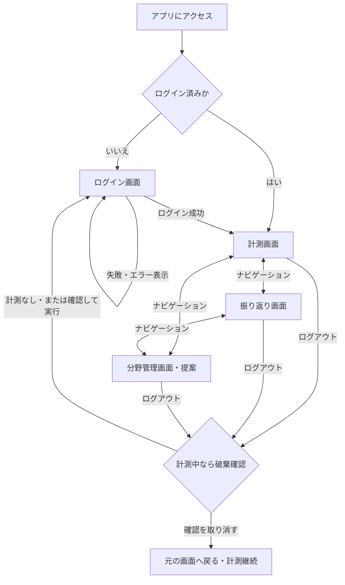
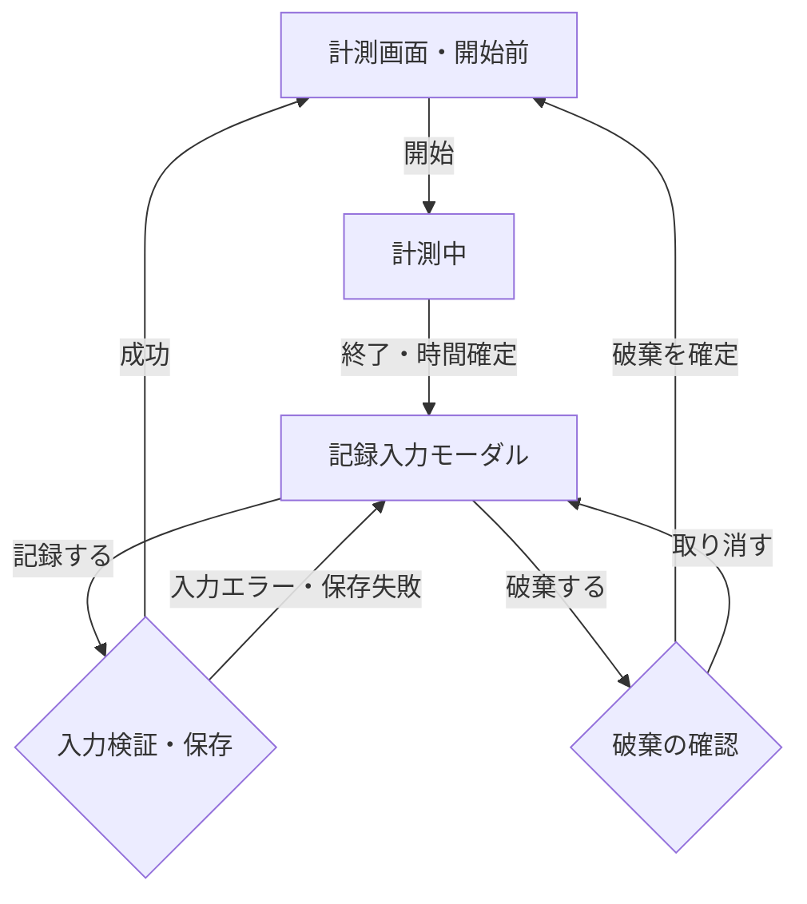
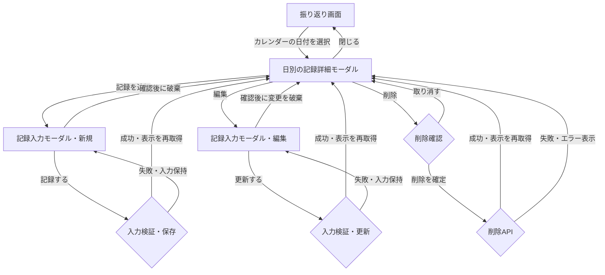

# 学習記録アプリ 画面遷移図

全体の完成像に対する画面遷移です。2週間版への切り分けは別途行います。
既存の決定を基にしていますが、画面のURLと分野管理を独立画面にする構成は提案です。アプリには未実装です。

## 主な画面の移動

- ログイン成功後、最初に表示するのは計測画面です。
- 振り返り画面には累計時間・分野別時間・カレンダーをまとめます。
- 分野管理画面には分野の一覧・追加・名前変更・削除をまとめる案です。管理操作の配置は未確定です。
- 全体仕様ではアプリ内の画面移動でも計測を継続します。
- 未認証・セッション切れの場合はログイン画面へ案内します。入力中の場合は、画面移動で未保存内容が失われることを伝えます。
- 記録入力モーダルを開いている間は背後の画面を操作しません。先に記録・更新または破棄を済ませます。

## 計測から記録する流れ

- 記録入力は別ページへの移動ではなく、計測画面の上でモーダルを開きます。
- 成功時はモーダルを閉じ、次の計測を始められる状態に戻します。入力失敗時は内容を残します。
- 「閉じる」や背景クリックでは入力モーダルを閉じません。
- 通信切断で結果が不明な場合は保存失敗と断定せず、結果を確認できないことを表示します。結果確認へ進む際の入力保持などの詳細は別途決めます。

## カレンダーから記録を確認・追加・編集・削除する流れ

- 日別の詳細は閲覧用で「閉じる」があります。入力モーダルの2択とは別です。
- 記録がない日も日別詳細を開き、手動追加できます。
- 追加・編集時はいったん日別詳細を隠し、入力モーダルを表示する案です。モーダルを重ねて操作しない構成にします。
- 追加・更新・削除後に日別詳細へ戻る構成は提案です。表示中の日付を維持して再取得し、学習日を変更した場合は移動先の日付を案内します。カレンダーと集計も更新します。
- 手動追加の初期日は、決定済みの方針どおり「今日」です。カレンダーで選択した日を初期値に変更するかは未決定です。
- 入力の破棄確認を取り消した場合は、そのまま入力を続けます。

## 画面のURL案

| 画面 | メソッド・URL案 | 状態 |
|---|---|---|
| ログイン | GET /login | 決定済み |
| 計測 | GET / | 提案 |
| 振り返り | GET /review | 提案 |
| 分野管理 | GET /subjects | 提案 |

モーダルには独立した画面URLを設けない案です。データは設計済みの `/api/...` から取得します。
ログイン送信は `POST /login`、ログアウトは `POST /logout` で行います。ログアウトをGETのリンクで実行しません。

## 図の読み方

- 四角：画面、表示状態、モーダル。
- ひし形：確認・成功と失敗などの分岐。
- 矢印の文字：移動のきっかけとなる操作や結果。
- モーダルへの矢印は、ページ遷移ではなく表示の切り替えを表します。

細かな配置や装飾はこの図の対象外です。全体の設計方針は [design-notes.md](design-notes.md) を参照してください。
